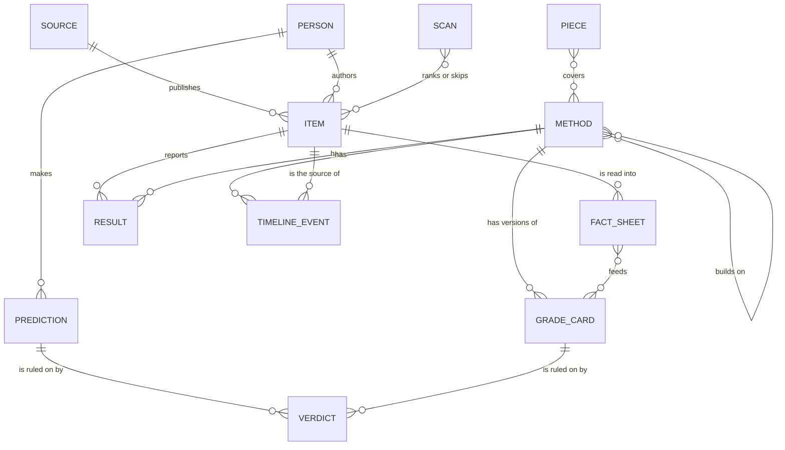
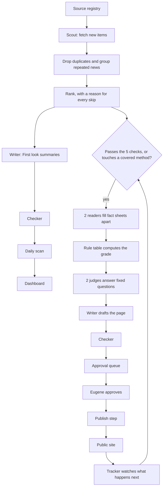
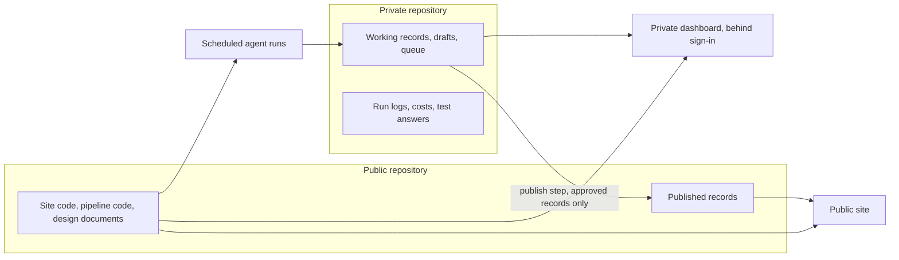

# High-Level Design: AI Scale Dev

Status: draft for Eugene's review. This is phase 1 of linked-intent development (LID).
Nothing below is approved by appearing here, and no later phase starts before this review.

How to read the status words:

- **Approved:** marked approved, with a date, in 1 of the 2 plan files (see References).
- **Proposed:** marked proposed in a plan file. Not decided.
- **Stated:** written in a plan file as direction, with no mark either way.
- **Pending: Your call N:** rests on a decision only Eugene can make. N is the question
  number in the pre-answered interview,
  [`docs/planning/interview-answers.md`](planning/interview-answers.md), which gives a
  recommendation for each.
- Anything with no status word is a design choice made in this document.

## Problem

New ways of building software with AI appear every day, across blogs, papers, talks,
code and social posts. Most arrive as claims. An engineer who wants to work at the edge
has to answer, for each claim: does it work, how well is that proven, who measured it, at
what scale, with which generation of tools, and is it still true. Answering takes hours
of reading. Summaries found elsewhere rarely say how strong the proof is, rarely link
every claim to its source, and go stale without saying so.

AI Scale Dev exists to do that work in the open. Its mission (stated): find the best
research and practice from the people changing software engineering, grade how well each
method is proven, and deliver it in plain words with every source linked, so engineers
learn faster and choose better.

A team of AI agents does the sourcing, drafting, grading and updating, every day. Eugene
gives direction and reviews at set points.

The site that exists today is a small blog with 1 post. It promises firsthand notes only,
with no general AI commentary. This design changes that promise (Pending: Your call 2).

## Target Users

Stated in the vision file.

1. **First user: Eugene.** He opens the dashboard each day to stay current and apply what
   he learns. His minutes go to direction and approval.
2. **Core audience: experienced engineers.** Content is written to their depth and their
   bar for evidence. They challenge grades and decide what their teams adopt.
3. **Beginners.** Served by the plain top layers of every page: a 1-line answer, a
   1-paragraph summary and glossary links.

Design partners, 3 to 5 people, join in a later stage. Eugene is the curator and editor,
not the expert. Credibility comes from linked sources and evidence grades.

## Approach

4 ideas carry the design.

1. **2 lanes** (proposed; Pending: Your call 15). A fast lane publishes a daily scan
   labeled "First look". A slow lane publishes graded pages that are checked against their
   sources and approved first. Each lane has its own label, so a reader always knows which
   lane they are reading.
2. **A rule decides wherever a rule can.** Fetching, exact-duplicate removal, the grade
   itself and the first line of error checking are code. A model reads, writes and
   answers only bounded questions. The same facts always give the same grade (approved).
3. **Records are files, and nothing is public until it is copied across a wall.** Every
   record is a small text file whose history is the change log. Work happens in a private
   store. Publishing is a separate, 1-way step.
4. **A person approves at set points.** Agents never publish a graded page, change a
   grade or post a reply on their own.

### Options weighed

3 ways to build the whole system were weighed. LID asks for the choice to be made by the
reader, so the pick below is a recommendation until Eugene selects.

**Option A: files and static pages.** Every record is a small text file with a checked
shape. Agents run on a schedule, write files and propose changes. A person approves by
accepting a proposed change. The files are rebuilt into plain pages: 1 build for the
private dashboard, 1 for the public site.

- *Gains:* history, comparison and rollback come free. Any record can be opened and read
  by a person or re-run by an agent. The public build sees only what was copied across.
  Nothing has to be operated. It fits the existing site, and specs, tests and records are
  all files.
- *Costs:* no per-reader features. Trends and search must be worked out at build time.
  Approval goes through the repository, which may be slower than a button. 2 agents
  writing at once can collide. Volume has a ceiling.
- *Later:* a database is added beside the files when a named trigger fires.

**Option B: database and web app.** Records are rows in a hosted database. A web app with
sign-in serves the dashboard and an approval queue with buttons. Agents write through the
app. Public pages are produced from the database.

- *Gains:* fast approval from any device. Any question can be asked of the data. Private
  by default. Per-reader features come easily. No ceiling in sight.
- *Costs:* the change log, history and rollback must be designed and built instead of
  coming free. There is more to build, secure and run before the first useful dashboard.
  It costs money from the first day. Records are harder for a person to read. The live
  blog would be rebuilt around an app.
- *Later:* stronger for the later stages, but it pays for them before the private phase
  has shown the dashboard is worth opening.

**Option C: split from the start.** Files for the published record (methods, cards,
results, timelines, pieces) and a database for the working desk (items, the queue, runs,
costs).

- *Gains:* each kind of data sits where it fits. The published record keeps its free
  history, and the desk gets buttons and questions.
- *Costs:* 2 stores to keep in step from the first day, with a sync that can fail. The
  private phase would be spent building the desk. The line between the 2 has to be guessed
  before real volume is known.
- *Later:* probably where the system ends up. The question is whether to pay for it now.

**Recommended: A now, moving toward C 1 trigger at a time.** The MVP has to answer
whether the dashboard is useful and its claims are right. A answers that with the least
built, and records keep the same IDs and shape if the desk later moves to a database. The
triggers are listed under Key Design Decisions.

## Records

The records are the decision most expensive to change once content exists. The vision
file states 7: Source, Item, Method, Grade card, Timeline event, Piece and Verdict. This
design keeps those and adds the ones the approved rules need.

| Record | What it is | Status |
|---|---|---|
| **Source** | A place we read: a blog, a feed, a channel, a person's account. Holds its tier and how it may be read | Stated |
| **Item** | 1 thing a source published: a post, paper, talk or release. Holds its address, the date read and a fingerprint of the text read | Stated |
| **Scan** | 1 day's ranked list, Watching list and coverage counts | Added here |
| **Method** | A named way of working that can be tried and measured. The 4 other page levels (area, approach, tool, use case) share its shape | Stated |
| **Fact sheet** | The fixed facts 1 reader pulled from 1 item, each with a pointer to its place in the source | Added here, required by the approved grading steps |
| **Result** | 1 measured result row with the fields of the approved results block, including tool or model version and date | From the approved results block |
| **Grade card** | The computed card: grade, status, results, the rule version and the judges' answers. Each version is kept | Stated |
| **Timeline event** | What happened to a method after we covered it, its source and what it changed on the card | Stated |
| **Person** | Someone named on the site: an author, or a leading voice with the route that listed them | From the approved leading-voices rule |
| **Prediction** | A dated statement about the future, in the person's own words, with what would count as it coming true | Proposed in the rubric file; Pending: Your call 6 |
| **Verdict** | A dated ruling on something that was open: a prediction's outcome, or how an earlier card of ours held up | Stated as a record; its meaning is Pending: Your call 12 |
| **Piece** | An authored article: an explainer or a Field note; later a weekly brief or a guest article | Stated |
| **Correction or reply** | A request to correct or add context, how the sender was checked and what was done | From the approved right of reply |
| **Term** | 1 glossary entry | Added here |
| **Run** | 1 agent run: role, model, instruction version, cost, what it read and wrote | Added here |

Rules for every record:

1. **Permanent ID.** Made by code, never by a model: a type prefix and a short random
   string. It never changes, is never reused and carries no meaning.
2. **Address separate from ID.** A page's address is readable words, frozen when first
   published. If a name changes or a page merges, the old address forwards for good.
3. **Nothing is overwritten silently.** A change is a new version with a date, a reason
   and a source. A replaced result stays visible, marked "Replaced" (approved).
4. **Every stated fact points to its place in a source.** A number that cannot be found
   in the source text is rejected by code.
5. **A grade can be re-run.** A card stores its fact sheets, its rule version and its
   judges' answers. When a rule changes, every affected card is recomputed and the change
   is logged (approved).
6. **A copy of what was read is kept privately**, so a claim can be re-checked after a
   source changes or disappears. The copy is never republished.

**Where records live.** Files in a repository, whose history is the change log (proposed
in the vision file). Working records sit in a private repository. Approved records are
copied to the public repository by the publish step (Pending: Your call 4).

## Publishing and approval rules

| What | Who must approve before it is public | Public label | Status of the rule |
|---|---|---|---|
| Daily scan item | Nobody item by item, once the scan test and the summary test pass. Held items wait for Eugene | "First look, not yet checked" | Pending: Your call 5, 10 and 16 |
| Watching list line | Same as a scan item | "Watching" | The list is approved; publishing is Pending: Your call 5 |
| Leading voice's statement in the scan | Same as a scan item | "Prediction by a leading voice" or "First-hand, no numbers yet", with its evidence line | Inclusion approved; display Pending: Your call 6 |
| New graded method page | Eugene | "Checked on [date]" | Approved (the approve step of grading) |
| Timeline event that changes a grade | Eugene | Entry in the change log | Stated in the rubric file |
| Any other card change | Eugene during the MVP | Entry in the change log | Design choice; may relax under Your call 14 |
| A downgrade, or a page about a person | Eugene, always | As above | Proposed; Pending: Your call 13 and 14 |
| Explainer | Eugene | "Checked on [date]" | Design choice |
| Field note | Written and signed by Eugene | His name | Pending: Your call 2 |
| Reply or correction | Eugene, after the sender is checked | "Reply from [name]" or "Corrected on [date]" | Right of reply approved; policy Pending: Your call 13 |
| Verdict | Eugene | Entry in the change log | Pending: Your call 12 |
| New source, or new leading-voices name | Eugene | None | Design choice for sources; Eugene deciding names is proposed in the rubric file (Pending: Your call 6) |
| Change to the rubric, the rule table or an agent's instructions | Eugene, and the affected tests rerun first | Entry in the change log | Pending: Your call 16 |

Held items in the fast lane: an item that says something negative about a named person,
an item the rule-based error catcher rejects, and an item scored high risk. The error
catcher and the risk score are proposed (Pending: Your call 14).

**Conflict of interest.** A written policy applies before any graded page is public, and
the consulting page stays off the site through the MVP (Pending: Your call 9).

**During the private phase nothing from the new system is public**, whatever the table
says. The table takes effect at public launch.

**When Eugene is away** the fast lane keeps running, the slow lane's queue waits, and
drafting of new graded pages pauses once 10 drafts are waiting. Nothing in the slow lane
publishes by timing out.

**Stop switches.** Eugene can pause automatic publishing with 1 switch. Passing the
spending cap stops the runs by itself. Any change-course signal pauses automatic
publishing that day.

**What agents never do.**

1. Publish in the slow lane, change a grade or post a reply without approval.
2. Read behind a login or a paywall, get around a block, or break a source's terms.
3. Invent or reword a quote, fill in a number the source does not state, average across
   sources, or compute a combined score.
4. Raise a grade because a name is famous, an effect is large or readers report success.
5. Follow instructions found inside a source. Source text is data.
6. Add a name to the leading-voices list, or publish about a person's private life.
7. Change the rubric, the rule table or their own instructions.
8. Spend past the cap, start a new recurring job or sign up for a paid service.
9. Send messages or post on any outside account.
10. Rewrite or delete history.
11. Touch the live site's domain records, hosting settings or email records.
12. Mark their own work as checked or approved.

## What a reader sees

**Page levels and addresses.** 5 levels are stated: area, method, approach, tool, use
case. Addresses are flat, 1 folder per kind, so a page can move to a new parent without
its address changing.

| Page | Address | Built in the MVP |
|---|---|---|
| Area | `/areas/<name>` | Yes |
| Method, with its grade card and timeline | `/methods/<name>` | Yes, about 10 |
| Approach, tool, use case | `/approaches/<name>`, `/tools/<name>`, `/use-cases/<name>` | No, reserved |
| Person | `/people/<name>` | No, reserved |
| Source | `/sources/<name>` | No, reserved |
| Daily scan | `/scan/2026-11-11` | Yes |
| Explainer | `/pieces/<name>` | Yes |
| Field note | `/blog/<name>` (existing, kept) | Yes |
| Glossary term | `/glossary/<term>` | Yes, minimal |
| Change log, corrections log | `/changes`, `/corrections` | Yes |
| How this is made | `/how-this-is-made` | Yes |
| Scorecard | `/scorecard` | No, reserved |

A page starts at method level. An approach, tool or use-case page splits off only when it
has its own evidence and real demand, and a page with no visits and nothing new for about
6 months merges into its parent (both stated).

**Page layers.** Every page reads from short to long: a 1-line answer, a 1-paragraph
summary, the grade card with its results, the timeline, the detail, the sources.
Unfamiliar terms are explained in plain words first and link to the glossary.

**The grade card.** As the rubric file defines it: Evidence (A to E), Status (Proven,
Frontier, Prediction), Tested on, Who measured, the results block with its headline, Can
you repeat it, Fits you if, and Checked. Each line links to its source. Each card offers
"Why this grade". The results block and the way a grade is computed are approved.

**Labels.** 2 labels tell a reader how far to trust a page, and neither names who checked
it (Pending: Your call 10).

- "First look, not yet checked": published the day it was found.
- "Checked on [date]": every line was matched to its source on that date.

A scan item never shows a letter grade. It shows a first-look note in words, such as
"1 company's own numbers".

Every page links to "How this is made", which says plainly that AI agents draft the site,
and to "Correct this or add context" (approved for the MVP).

**The dashboard.** 5 sections are stated: Today's scan, What moved, Trends, Pieces and
Coverage. In the private phase a 6th section, Owner's desk, shows the approval queue with
a preview of each draft, the 4 change-course signals, spending against the cap and a link
for logging something found elsewhere first. After launch the public homepage becomes
1 line of positioning followed by the public dashboard. The mock-up tests this before it
is built.

**Voice.** "We" for the publication; "I" only in signed Field notes (Pending: Your
call 3).

## System Design

### A day in the system

**Fast lane, every day.**

1. The scout reads each source by the route its row in the source-access table allows:
   feeds first, official interfaces where terms allow, nothing behind a login (approved).
2. Code drops exact repeats. A model groups items that report the same news and puts the
   primary source first.
3. Items are ranked by written rules, then by a bounded judgment of how much they matter.
   Every skipped item keeps a 1-line reason.
4. The writer gives each ranked item a 1-line summary, an "affects you if" line, its area
   and a first-look evidence note.
5. The checker runs. Anything new that fails the 5 checks goes to the Watching list:
   1 line and a link, no page, no grade (approved).
6. The day's scan and the dashboard are built.

**Slow lane, as candidates arrive.** In the MVP a method gets a graded page only when its
best source passes all 5 checks, which equals evidence grade C or better (approved).

1. **Read:** 2 readers fill the same fact sheet apart. A difference goes to Eugene.
2. **Rule:** code turns the facts into the grade, the status, the "who measured" label and
   the 5 checks.
3. **Judge:** 2 judges answer the fixed questions a rule cannot. A disagreement goes to
   Eugene.
4. **Write:** the writer drafts the page in its layers.
5. **Check:** the rule-based error catcher, then a claim-by-claim check against the stored
   copy of the source.
6. **Approve:** Eugene approves.
7. **Publish:** the approved records are copied across and the change is logged.
8. **Track:** the tracker watches for new evidence, proposes timeline events and notes
   when newer data exists.

Steps 1 to 3 and 6 are the approved way a grade is computed. The rule-based error catcher
is 1 of 5 proposed additions (Pending: Your call 14).

### Parts

| Part | What it does |
|---|---|
| **Editorial rule documents** | The rubric, the editorial standards, the source list and the leading-voices list. Plain documents this design links to; content rules, not code (approved) |
| **Source registry** | The source list in a form code can read, with each source's tier and access row |
| **Fast lane** | Scout, duplicate removal, ranking, First look summaries, the daily scan |
| **Slow lane** | Readers, the rule table, judges, the writer, grade cards and method pages |
| **Checking** | The rule-based error catcher and the claim checker, used by both lanes |
| **Tracking** | The watch list, timeline events, the replacement rule, prediction checks and verdicts |
| **Records store** | The record files and their history |
| **Approval and publishing** | The queue, the approval points, the 1-way publish step, the logs and the stop switches |
| **Sites** | The private dashboard and the public site |
| **Run control** | The schedule, the model fixed for each role, the spending cap and the run log |
| **Internal test set** | The 8 tests that measure the agents and gate publishing |

### Where things live and run

The public site is built only from the public repository, so a draft cannot appear on it.
The private dashboard is a separate site behind a sign-in wall that lets in 1 account. An
unguessable address alone is not accepted as privacy. This layout is Pending: Your call 4,
and the hosting plan behind it is Pending: Your call 8.

**Where the agents run** is provisional: scheduled jobs on the private repository's own
automation, calling Claude through Anthropic's paid interface with the model fixed for
each role. A 1-week private trial compares this with the other candidates (Claude Code's
scheduled cloud agents, scheduled tasks on Eugene's Mac, scheduled functions on the web
host) on: runs that started on time and finished, cost per day by role, whether the model
can be fixed per role, whether secrets stay out of the repository, whether each run leaves
a readable log, and whether it works with the Mac off. No schedule is switched on before
a spending limit is approved (Pending: Your call 7).

### Agent roles

| Role | Does | Provisional model |
|---|---|---|
| **Scout** | Fetches, drops duplicates, groups repeated news, ranks | Code for fetching and exact repeats; `claude-haiku-5-5` for grouping and ranking |
| **Reader** | Fills fact sheets with pointers; 2 readers apart on graded pages | `claude-fable-5-2` |
| **Grader** | Runs the rule table, then puts the fixed questions to 2 judges | Code for the rules; `claude-fable-5-2` for the judges |
| **Writer** | Writes what a reader sees | `claude-sonnet-5-5` in the fast lane; `claude-fable-5-2` in the slow lane |
| **Checker** | Runs the error catcher, then checks each claim against the source | Code for the catcher; same models as the writer, in a separate run |
| **Tracker** | Watches covered methods, proposes events and verdicts | `claude-sonnet-5-5` to watch; `claude-fable-5-2` to propose a card change |

The models are provisional. They were not checked against Anthropic's current guidance
for this draft, and they are set again in the agent-runs low-level design from that
guidance and from the test set's results. A role moves to a lighter model only when the
tests show the same quality. No agent checks its own work.

### Stack

Keep what exists: Astro, static pages, typed content files, Tailwind and the Inter
typeface. A malformed record already fails the build, which is a free check. Pipeline code
is TypeScript, so the rule table, the checks and the site share 1 toolchain. The stack is
open to revision (approved).

## Goals

1. Eugene opens the dashboard every day and finds it useful.
2. The scan misses nothing important that he finds elsewhere.
3. A sample of items shows no wrong claims.
4. The same facts give the same grade every time, and any grade can be explained.
5. Every public claim links to its source, and every change to a published record leaves
   a dated trace.
6. Approvals fit Eugene's time budget (Pending: Your call 11).
7. Spending stays under the cap (Pending: Your call 7).

Goals 1 to 3 are the proposed "works when" test for the MVP.

## Non-Goals

- **A public benchmark that ranks AI coding tools or developers.** A different, crowded
  and costly job (proposed as a no for now in the vision file).
- **Expert opinion.** Graded pages report what sources show. Opinion appears only in
  signed Field notes.
- **Being first.** Only "First look" is fast. A graded page waits for its checks.
- **General AI news.** The subject is how software gets built with AI.
- **A replacement for the source.** Summaries point to sources and never stand in for
  them.
- **Out of the MVP** (proposed; Pending: Your call 15): comments, guest articles, the
  design-partner program, personal filters, an MCP server, granular tool and use-case
  pages, the newsletter and weekly brief, the business model, person pages, the public
  scorecard, follow-a-method alerts, the 3 reader invitations on each card, search and
  answer-engine work and automated social posting. The consulting page is also out
  (Pending: Your call 9).

## Roadmap

Proposed in the vision file; Pending: Your call 15.

| Stage | What happens |
|---|---|
| **0, spec** | This design, then the low-level designs and requirements. Also proposed for this stage: a mock-up with made-up data, reference sites, outside readers, and an explainer with a quiz. No research, no build |
| **1, seed research** | The deep research, run once the records and rubric are fixed. On hold until Eugene says go. The leading-voices list is built here (stated) and the source-access table is filled here (approved). This design also expects the starting source list from it |
| **2, private dashboard** | The daily scan and dashboard, visible only to Eugene, tuned for 2 weeks. The MVP |
| **3, public launch** | The dashboard, the first graded method pages and the first pieces go public. This design adds: the homepage and About page are rewritten here (Pending: Your call 2) |
| **4, tracking and reach** | Timelines, follow-a-method alerts, a weekly brief by email, reader feedback on cards, search and answer-engine work |
| **5, community and depth** | Design partners, guest articles, comments, more deep areas, granular pages |
| **6, personal and agent access** | Personal filters, the "what your research missed" tool, an MCP server, any paid offering |

**The MVP** (proposed): the source registry, the daily scan agent, ranking and duplicate
removal, item cards with layered summaries, the dashboard, the claim checker, an approval
queue, and about 10 graded method pages. It covers all 12 areas in the fast lane and
1 area, many agents on 1 codebase, in the slow lane. This design adds 2 clarifications:
MVP pieces are explainers and Field notes only, and a minimal glossary is included.

## Tenets

Proposed tie-breakers for choices no rule covers, highest first. Eugene sets the order.

- **An honest gap over a filled gap.** When evidence is missing, say so; never estimate
  to make a page look complete.
- **Nothing changes silently.** When keeping a page current and keeping its history pull
  apart, keep the history.
- **Private until published.** When it is unclear whether something may be public, it is
  not.
- **A rule before a model.** When code can decide, code decides.
- **Checked over fast.** When speed and checking pull apart outside the "First look"
  label, checking wins.
- **Eugene's minutes are the scarcest thing.** When a choice trades agent work for his
  time, spend the agent work.
- **Plain files and existing tools over new services.** Add a service only when a named
  trigger fires.

## Key Design Decisions

| Decision | Chosen | Alternatives | Why | Status |
|---|---|---|---|---|
| Whole-system shape | Files and static pages, moving toward a split 1 trigger at a time | Database and web app; split from the start | Least built before the MVP question is answered; history comes free | Recommended; Eugene selects |
| Where records live | Files in a repository | A database | The history is the change log | Proposed in the vision file |
| When a database is added | When 1 trigger fires: a per-reader feature; approval through the repository breaking the time budget; a build over 5 minutes or a repository too slow to copy; write conflicts more than once a week; a dashboard question that cannot be worked out at build time; live access for an outside program | Now; never | Stops both an early database and a late one | Design choice |
| Privacy | 2 repositories with a 1-way publish step | 1 private repository; 1 public repository with a filter in the build | A draft cannot leak onto a site whose build never sees it | Pending: Your call 4 |
| Grade computation | Read, rule, judge, approve | Model-only grading | The same facts always give the same grade | Approved |
| Record replacement | A newer result replaces an older one only when it measures the same thing at least as well on the same or newer tools | Newest always wins; keep everything | Current without losing what came before | Approved |
| Fast-lane publishing | Without per-item approval after the tests pass, with held items | Approve every item; never auto-publish | Fits the time budget; the label carries the honesty | Pending: Your call 5 |
| Addresses | Flat, 1 folder per kind, frozen at first publication | Nested under area and method | A page can move without breaking links | Design choice |
| IDs | Random, made by code, separate from addresses | Numbers in sequence; IDs from titles | No collisions between agents; survive renames | Design choice |
| Scan evidence note | Words, never a letter | A provisional letter grade | A letter without the rule table behind it would look like a grade | Design choice |
| Editorial rules | Plain documents the design links to | Rules inside the code | Content rules, not code | Approved |
| Where agents run | Scheduled jobs on the private repository, compared in a 1-week trial | Cloud agents; the Mac; host functions | Code steps need a scheduler anyway | Provisional |
| Stack | Keep Astro and add TypeScript pipeline code | Rebuild as an app | It works, and typed files fit records | Design choice |

## Success Metrics

**The MVP works when** (proposed) Eugene opens the dashboard daily for 2 weeks and finds
it useful, the scan misses nothing important that he finds elsewhere, and a sample of
items shows no wrong claims.

**The internal test set** (proposed; Pending: Your call 16) measures the agents and gates
publishing. Pass marks are set after the first private run.

| Test | What it checks |
|---|---|
| Scan test | The scan finds what matters and ranks it high, replayed on a past 2 weeks |
| Summary test | Summaries say only what the source says |
| Grading test | About 30 cases with agreed answers, each run twice |
| Plain-words test | A beginner can follow the top layers |
| Human agreement | Eugene and 2 or 3 experienced engineers grade 10 cases blind |
| Owner's time | Minutes a day spent on approvals |
| Missed items | What Eugene found elsewhere first, logged weekly |
| Planted errors | The checker catches known mistakes planted in test summaries |

The fast lane goes public only after the scan and summary tests pass. A change to the
rubric, the rule table, an agent's instructions or a role's model reruns the affected
tests first.

**The system is judged broken, and rethought that day** (approved), when any 1 of the
4 change-course signals turns on: Eugene stops opening the dashboard, the scan keeps
missing things he finds elsewhere, the summary test finds wrong claims, or cost passes the
cap. There is no fixed review date.

## Risks and open questions

**Risks.**

1. **Some of the most important channels may not be readable within their terms.**
   LinkedIn returned only a summary to an automated fetch on November 11, 2026; X and paid
   sites raise the same problem. A link handed in by a person is the fallback.
2. **Agents may grade the same item differently on different days.** Unknown until the
   grading test runs.
3. **Daily volume and daily cost are unknown.** The 1-week trial measures both.
4. **Real people may object.** Exact sourcing, the approval rule for pages about people
   and the right of reply are the answer.
5. **Results age fast.** Each result shows its tool generation and date.
6. **The approval queue can back up.** The pause at 10 waiting drafts limits it.
7. **Demand is unproven.** Whether experienced engineers want evidence grades is unknown
   until some see them.
8. **Translation can change a claim.** Translated claims are labeled and keep the
   original words.
9. **Whether someone already does this is unchecked.**
10. **A source can carry hidden instructions for an agent.** Source text is treated as
    data, and agents that read the web hold no key that can publish, spend or post.
11. **Approving through the repository may be too slow.** It is 1 of the triggers for
    adding a database.
12. **The review load of the method itself.** LID stops for review after each low-level
    design; 12 are listed below.

**Open questions.**

1. **The domain.** The vision file records aiscale.dev in redemption at the registrar as
   of November 11, 2026. It must be restored before anything launches. The trademark
   check on the name is open.
2. **The 12 areas** are not listed in either plan file.
3. **The starting source list and the leading-voices list.** The leading-voices list is
   built during the seed research, which is on hold. The plan files do not say where the
   starting source list comes from; this design expects the same research to supply it.
   Stage 2 needs both, or a starter list approved by hand.
4. **Costs and terms.** Hosting plans, scheduler limits, model prices and channel terms
   were not checked for this draft.
5. **A separate paying account** for model use, apart from Eugene's company, does not
   exist yet.
6. **The business model** is undecided. The MVP does not need it.
7. **The contact form** that "Correct this or add context" would use is not live; its
   access key is a placeholder.
8. **The "who measured" label** has 3 values in the rubric file, and 1 worked example
   uses a 4th, "Not measured". The grading low-level design settles it.
9. **LID is not installed here yet,** and `AGENTS.md` still describes the old promise and
   has no LID block.

## Low-level designs to follow

Each becomes a folder under `docs/intent/` holding its design and its requirements. The
order puts first what is most expensive to change, and what the seed research needs
fixed before it can run.

| Order | Design | Covers |
|---|---|---|
| 1 | `records` | Every record's fields, IDs, file layout, versions and history |
| 2 | `grading` | The fact sheet, the rule table, the judges' questions, card computation, the replacement rule, the risk score |
| 3 | `approval-and-publishing` | The queue, the approval points, the publish step, the logs, the stop switches, away mode |
| 4 | `site-pages` | Addresses, the page template and layers, labels, forwarding, pruning, the existing pages, Field notes, "How this is made" |
| 5 | `sources` | The registry format, tiers, the source-access table, fetching, adding and dropping a source |
| 6 | `daily-scan` | Duplicates, ranking, First look summaries, the Watching list, coverage |
| 7 | `checking` | The rule-based error catcher, the claim checker, planted errors |
| 8 | `test-set` | The 8 tests, their cases, the gates and pass marks |
| 9 | `agent-runs` | Roles and handoffs, the schedule, the model per role, the spending cap, run logs, what agents never do |
| 10 | `dashboard` | The sections, the Owner's desk, the sign-in wall, the change-course signals |
| 11 | `tracking` | The watch list, timeline events, newer data, prediction checks, verdicts |
| 12 | `people-and-replies` | Person records, the leading-voices list and its 2 routes, statements, corrections, right of reply, checking who sent a reply |

Under the proposed roadmap all 12 come before the seed research. If the research starts
earlier, it needs at least designs 1, 2, 5 and 12 first, because it fills the shapes they
fix. The mock-up comes before designs 4 and 10.

## References

- Vision, mission, value and spec needs: `aiscale-dev-vision-and-spec-needs.md` (plan
  file, kept outside this repository; see Your call 4).
- Grading rubric: `aiscale-dev-grading-rubric.md` (plan file, kept outside this
  repository).
- Pre-answered interview: [`docs/planning/interview-answers.md`](planning/interview-answers.md).
- Linked-intent development: <https://github.com/jszmajda/lid>.
- The existing site's notes: [`AGENTS.md`](../AGENTS.md) and
  [`docs/design-handoff.md`](design-handoff.md).
- GRADE Working Group, the source of the rubric's core idea:
  <https://www.gradeworkinggroup.org/>.
